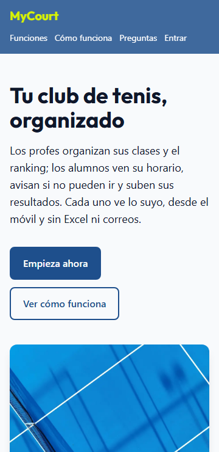
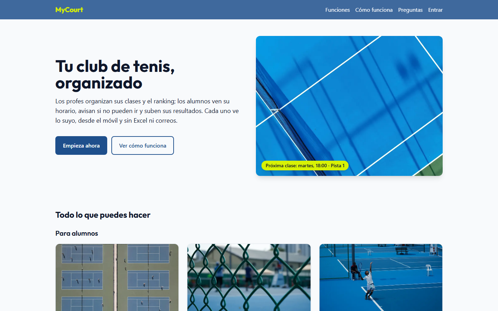
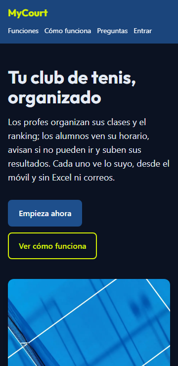
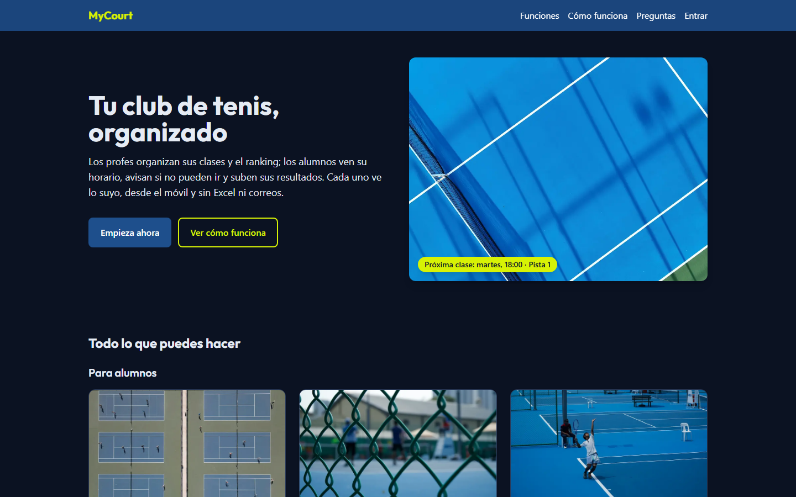

# LemoncodeLab1

Laboratorio del Módulo 1 de Lemoncode: landing con Vite + Tailwind CSS v4, sin JavaScript.

## Tema elegido

**Opción B: la UI de mi TFM.**

Juego al tenis en un club y voy a clases. Mi profesor lleva el horario de las clases, las ausencias y el ranking interno en un Excel, y recibe las inscripciones y los resultados por correo. Mi TFM, **MyCourt**, es la app que le quita ese trabajo: hay dos roles, **alumno** y **profesor**, y cada uno ve solo sus secciones. El alumno consulta su horario, avisa si no puede ir a una clase y juega el ranking; el profesor organiza sus grupos, ve las ausencias en su calendario y gestiona el ranking.

En este laboratorio maqueto la **landing** de la app: cabecera, hero, funciones por rol, "Cómo funciona", preguntas frecuentes, formulario de alta y pie. Solo maquetación: los datos de la app (horarios, ausencias, jugadores…) son inventados.

## Cómo arrancarlo

```bash
npm install
npm run dev
```

Abre la URL que muestra Vite en la terminal (por defecto, http://localhost:5173).

Otros scripts:

| Script               | Para qué                                                                                                                       |
| -------------------- | ------------------------------------------------------------------------------------------------------------------------------ |
| `npm run dev-mobile` | Arranca Vite con `--host` para abrir la página desde el móvil (misma wifi), con la dirección "Network" que sale en la terminal |
| `npm run build`      | Genera la versión final en `dist/`                                                                                             |
| `npm run preview`    | Sirve `dist/` para probar la versión final                                                                                     |
| `npm run format`     | Ordena las clases de Tailwind y formatea con Prettier                                                                          |

## Cómo conecto Tailwind

Elijo la **opción 1: el plugin de Vite** (`@tailwindcss/vite`).

Elijo el plugin de Vite porque es la integración nativa y recomendada para Vite: menos configuración y dependencias, y compilación más rápida. PostCSS tendría sentido si necesitara otros plugins de PostCSS o una herramienta sin plugin propio.

- Configuración: `vite.config.js` con `plugins: [tailwindcss()]`.
- Hoja de estilos: `src/style.css` con `@import "tailwindcss";` y el `@theme`, enlazada desde `index.html` con un `<link>` (el proyecto no usa JavaScript).
- Fuente de los títulos (Outfit) instalada con `@fontsource-variable/outfit` e importada desde el CSS: se sirve desde el propio proyecto, sin pedir nada a Google.
- Prettier + `prettier-plugin-tailwindcss` ordena las clases siempre igual.

## Capturas

### Móvil (360 px)



Página completa: [screenshots/movil-completa.png](screenshots/movil-completa.png)

### Escritorio (1440 px)



Página completa: [screenshots/escritorio-completa.png](screenshots/escritorio-completa.png)

### Modo oscuro

Se activa solo si el sistema está en modo oscuro.





## Checklist

### Obligatorios

- [x] **O1 · Estructura semántica**: `<header>`, `<nav>`, `<main>`, `<section>` con su título, `<footer>`; un solo `<h1>` y títulos sin saltos (h1 → h2 → h3 → h4); tarjetas en `<article>`; listas de enlaces en `<ul>`; todas las imágenes con `alt` (`alt=""` en las fotos decorativas de las tarjetas).
- [x] **O2 · Tema visual con `@theme`**: azul de marca en 3 tonos (`pista-claro`, `pista`, `pista-oscuro`), acento amarillo `pelota`, neutros y `error`. Títulos con Outfit (`--font-titulos`). Ningún color suelto en las clases.
- [x] **O3 · Cabecera con flexbox**: `flex justify-between items-center` con `flex-wrap`; en móvil el menú baja a una fila bajo el logo.
- [x] **O4 · Hero**: titular, texto, dos botones y foto en `grid md:grid-cols-2`, con un chip de la app sobre la foto (`relative` + `absolute`).
- [x] **O5 · Rejilla de tarjetas con grid**: 6 tarjetas en dos bloques por rol ("Para alumnos" y "Para profesores"), `grid-cols-1 sm:grid-cols-2 lg:grid-cols-3`, con imagen, texto, dato destacado y botón alineado abajo.
- [x] **O6 · Pasos con flexbox**: "Cómo funciona" en un `<ol class="flex flex-col md:flex-row">`, pasos con `flex-1` y número centrado en un círculo.
- [x] **O7 · Pie de página**: 3 columnas con `grid md:grid-cols-3` (marca, enlaces y contacto en `<address>`) y línea final con `border-t`.
- [x] **O8 · Accesibilidad mínima**: **Lighthouse · Accesibilidad: 100** en móvil y en escritorio. Todo se usa con el tabulador, con foco visible (lo he comprobado a mano) y no hay texto metido en imágenes.
- [x] **O9 · README + bitácora de IA**: este documento.

### Opcionales

- [x] **P1 · Modo oscuro**: nivel básico, sigue la preferencia del sistema (`prefers-color-scheme`), sin JavaScript. Explicación más abajo.
- [x] **P2 · Cabecera fija con efecto cristal**: `sticky top-0 z-50 bg-pista/85 backdrop-blur-md`. Explicación más abajo.
- [ ] P3 · Planes con tarjeta destacada
- [x] **P4 · FAQ plegable sin JavaScript**: 6 `<details>`/`<summary>` con flecha que gira (`group` + `group-open:rotate-180`).
- [x] **P5 · Formulario con estados**: `<label>` en cada campo, `focus:`, `user-invalid:` y mensaje de error con `peer` + `peer-user-invalid:block`. Sin ejemplo de `disabled:`: el único campo desactivado que tenía (el club) lo quité porque no aportaba nada, y un botón desactivado sin JavaScript no se podría volver a activar.
- [ ] P6 · Bento grid
- [x] **P7 · Animaciones con cabeza**: elevación y zoom de las tarjetas, giro de la flecha de la FAQ y desplazamiento suave a las secciones, todo con `motion-safe:`. Explicación más abajo.

### Desafíos

- [ ] D1 · Menú hamburguesa sin JavaScript
- [ ] D2 · Componentes con container queries
- [ ] D3 · Multitema
- [x] **D4 · Tus propias utilidades**: `@utility foco-pelota`, `foco-enlace` y `contenedor`, y clases en `@layer components` para las piezas repetidas. Explicación más abajo.
- [ ] D5 · Layout de aplicación
- [ ] D6 · De captura a código
- [x] **D7 · Lighthouse al 100**: **100 en Rendimiento, Accesibilidad, Buenas prácticas y SEO**, en móvil y en escritorio (sobre `npm run build` + `npm run preview`).

## Decisiones técnicas

### P2 · Por qué `sticky` y no `fixed`, y por qué `z-50`

- **`sticky`** se comporta como un elemento normal hasta que llega a `top-0`, y entonces se queda pegado. Sigue ocupando su sitio en el flujo, así que no tapa el principio de la página.
- **`fixed`** saca la cabecera del flujo. Habría que añadir al `<body>` un `padding-top` con la altura exacta de la cabecera, y esa altura cambia en móvil, donde el menú baja a una segunda fila.
- **`z-50`**: las tarjetas usan `transform` en el hover (`-translate-y-1`, `scale-105`). Un elemento con `transform` crea su propio contexto de apilamiento y se pinta en el orden del documento, por encima de una cabecera anterior que no tenga `z-index`. Sin `z-50`, al hacer scroll las tarjetas pasarían por encima de la cabecera.
- **Contraste con transparencia**: el azul va al 85 % (`bg-pista/85`) y no más bajo, porque, con contenido blanco o amarillo pasando por detrás, el logo amarillo dejaría de llegar a 4,5:1.
- **`scroll-pt-*`** en el `<html>`: al saltar a una sección, el navegador deja un hueco arriba para que la cabecera fija no tape el título.

### P7 · Animaciones

- Todo lo que se mueve (`-translate-y-1`, `scale-105`, `rotate-180`, `scroll-smooth`) lleva `motion-safe:`. Si el usuario pide reducir el movimiento en su sistema (`prefers-reduced-motion`), no se mueve. Los cambios de color y sombra no lo llevan.
- En las tarjetas, `group` en el `<article>` y `group-hover:scale-105` en la imagen, que está dentro de un `<div class="overflow-hidden">` para que el zoom no se salga.
- En Tailwind v4, `hover:` solo se aplica con ratón (`@media (hover: hover)`). Por eso cada `hover:` lleva su pareja `focus-visible:` o `focus-within:` (teclado) y `active:` (dedo), y el `<body>` lleva `ontouchstart=""`, porque sin él iOS Safari no activa `:active`.

### D4 · Cuándo extraer clases y por qué no abusar de `@apply`

Sigo el criterio del curso: **solo extraigo lo que se repite** (la misma lista de clases dos o más veces).

- **`@utility`** para patrones pequeños y transversales, sin marcado propio: `foco-pelota` y `foco-enlace` (anillo de foco amarillo, y azul o amarillo según el modo) y `contenedor` (`mx-auto max-w-6xl px-4`). Funcionan como cualquier utilidad y se pueden combinar con otras.
- **`@layer components`** para piezas con marcado propio que se repiten: `.tarjeta`, `.boton-principal`, `.boton-secundario`, `.pregunta`, `.campo`… En un proyecto con componentes (Astro, React) no harían falta: las clases vivirían una vez dentro del componente. En HTML plano, sin plantillas, esta es la forma de no copiar y pegar.
- **Lo que aparece una sola vez se queda con sus clases en el HTML**, aunque sean muchas (por ejemplo, la cabecera). Pasarlo a `@apply` solo lo mueve a otro archivo, sin evitar ninguna repetición, y te devuelve los problemas del CSS de siempre: inventar nombres, ir al CSS para saber cómo es un elemento y perder el autocompletado en el HTML. Para que se lea bien, Prettier ordena las clases.
- **Un límite de v4 que me encontré**: `@apply` solo acepta utilidades, no otra clase de `@layer components`. El botón de las tarjetas lleva por eso dos clases (`boton-secundario tarjeta-boton`), y `.tarjeta-boton` está declarada después de `.boton-secundario` para que, dentro de la misma capa, su padding gane.

### P1 · Modo oscuro con tokens semánticos

- Elijo el nivel básico, **seguir la preferencia del sistema**, para que el proyecto siga sin JavaScript. Un botón para cambiarlo necesitaría JS para poner y quitar la clase `dark` y para recordarlo al recargar.
- En lugar de llenar el HTML de `dark:`, uso **tokens semánticos** que cambian de valor dentro de `@media (prefers-color-scheme: dark)`, como recomienda la skill `tailwind-design-system` del curso: `--color-fondo`, `--color-texto`, `--color-superficie`, `--color-borde`, `--color-enlace`, `--color-error`… El HTML dice `bg-superficie` o `text-enlace` y no sabe en qué modo está. Los colores de marca (`pista`, `pelota`, `tinta`) no cambian.
- La **variante `dark:`**, que en v4 usa esa misma media query, la reservo para los casos puntuales: el fondo de la sección del formulario (`dark:bg-pista-oscuro/40`) y un borde que separa el pie del fondo (`dark:border-t`).
- **Sobre fondo oscuro el acento es el amarillo**, como ya pasaba en la cabecera y el pie. Los botones secundarios, la flecha de la FAQ, los radios y el anillo de foco pasan de azul a amarillo, porque el azul `pista` sobre fondo oscuro no llega al contraste mínimo. El rojo de error también cambia a uno más claro.
- `color-scheme: light dark` en el `<html>` para que los controles nativos (radios, barras de scroll) también se pongan oscuros.
- Contraste medido en los dos modos, texto a texto contra su fondo real: el peor caso en oscuro es 6,2:1.

### P5 · `user-invalid:` en lugar de `invalid:`

Con `invalid:`, los campos obligatorios saldrían en rojo nada más cargar la página, porque vacíos ya son inválidos. `user-invalid:` espera a que el usuario toque el campo o intente enviar. El mensaje de error va **después** del `<input class="peer">` porque `peer-*` solo afecta a los hermanos que vienen detrás.

## 🤖 Bitácora de IA

**Herramienta:** Claude Code (extensión de VS Code). Para revisar el trabajo antes de entregarlo usé el agente `design-reviewer` y las skills del curso (`design-critique`, `accessibility-review`, `ux-copy` y `tailwind-clases-limpias`).

Durante todo el laboratorio llevé una bitácora de cada paso. Estos son los ejemplos en los que más tuve que corregir o decidir yo.

### Ejemplo 1 · `@apply` para "limpiar" la cabecera

#### Prompt

"Para no engorronar tanto el HTML, ¿podemos meter en el style.css un `@apply` para el header con esos estilos?"

#### Qué me dio

Antes de hacerlo, me desaconsejó la idea. La cabecera aparece una sola vez, así que `@apply` solo movería las clases a otro archivo, sin evitar ninguna repetición. Además, volvería a los problemas del CSS de siempre: inventar nombres, ir al CSS para ver cómo es el elemento y perder el autocompletado en el HTML. Como alternativa me propuso Prettier con `prettier-plugin-tailwindcss` para tener las clases siempre ordenadas, y reservar `@apply` y `@utility` para lo que se repita de verdad.

#### Qué corregí y por qué

El que tuvo que cambiar de idea fui yo. Configuramos Prettier con el plugin (en v4 necesita la opción `tailwindStylesheet`, porque no hay `tailwind.config.js`) y el formato al guardar en VS Code. A partir de ahí apliqué la regla de "extraer solo lo repetido", que es la que explico en el D4.

### Ejemplo 2 · El formulario de alta: campos que no tocaban

#### Prompt

"Vamos con el formulario de Apúntate."

#### Qué me dio

Un formulario con nombre, correo, rol, nivel de juego y un campo "Club" desactivado (para tener el ejemplo de `disabled:` que pide el P5), con `user-invalid:` y los mensajes de error con `peer`. Después le pedí cambiar el club por la opción "Niños / Adultos" y que la casilla del ranking solo apareciera para adultos. Lo resolvió sin JavaScript con `group` en el `<form>` y `hidden group-has-[#clase-adultos:checked]:flex` en la casilla. Me explicó que `peer` no servía porque el radio estaba dentro de su propio `<fieldset>`, y que `:has()` mira desde el formulario, que contiene a los dos.

#### Qué corregí y por qué

Al verlo me di cuenta de que el problema no era técnico, sino de producto: es el formulario para **pedir el alta**, y el nivel, el tipo de clase o el ranking no tienen sentido antes de tener cuenta. Quité todo eso y dejé nombre, correo y rol. La inscripción al ranking será una pantalla de la app para adultos con la sesión iniciada. La IA hizo bien todo lo que le pedí; lo que hubo que corregir fue lo que le pedí yo.

### Ejemplo 3 · Revisión con el agente del curso

#### Prompt

"Venga, adelante" (revisar el laboratorio con las skills y agentes del curso antes de entregar).

#### Qué me dio

Lanzó la revisión como la plantea el agente `design-reviewer`: un agente aparte que no había visto la conversación, que no toca código y que mide contra el enunciado. No tenía Playwright, así que hizo las capturas a 360 y 1440 px y midió contraste y scroll con Chrome sin ventana. No encontró nada crítico, pero sí 10 puntos:

- la cabecera medía 116 px en móvil;
- los enlaces del menú tenían 21 px de alto (la skill pide 24);
- los botones de las tarjetas iban a `#`;
- el alta se explicaba de dos formas distintas;
- había clases repetidas y efectos `hover:` sin pareja `active:`;
- el hero era "el de siempre".

Para el hero propuso un chip con un dato de la app encima de la foto.

#### Qué corregí y por qué

- **No acepté dos puntos.** Proponía añadir el rol "Familia" al formulario, pero aunque acceda un familiar, el alta se hace a nombre del niño o la niña. También proponía cambiar los datos de contacto del pie, y decidí mantenerlos.
- **El chip del hero no lo entendí**, y le pedí que me lo explicara con un dibujo antes de decidir. Lo acepté, pero había puesto "Pista 3" y **mi club solo tiene 2 pistas**: lo cambié a "Pista 1".
- **Al hacer las capturas para este README salió un fallo de su propio arreglo.** La pista "Mínimo 3 letras." que había añadido sobre el campo "Nombre" lo bajaba y quedaba desalineado con "Correo". Ahora va debajo del campo y se oculta cuando aparece el error.

### Ejemplo 4 · Cambio de enfoque a mitad del laboratorio

#### Prompt

"Te decía que era solo para el ranking de tenis, pero es para más cosas: que los profesores gestionen su horario de clases, que los alumnos vean sus horarios e indiquen que no pueden ir, y que los profes vean esos cambios en el calendario. Habrá varios tipos de usuarios (alumno, profesor) y cada uno tendrá acceso a unas secciones según su rol. ¿Le damos una vuelta a los textos y las cards?"

#### Qué me dio

Una propuesta, sin tocar nada hasta que yo decidiera:

- textos nuevos para el título, el hero y el pie;
- las 6 tarjetas repartidas en dos bloques por rol, "Para alumnos" y "Para profesores";
- nuevos pasos para "Cómo funciona".

Como alternativa, una sola rejilla con una etiqueta de rol en cada tarjeta. Para los dos bloques usó una `<section>` con su `<h3>` en cada uno y bajó los títulos de las tarjetas a `<h4>` para no saltar niveles.

#### Qué corregí y por qué

Elegí los dos bloques por rol, porque así la idea de los roles se ve en la estructura de la página y no solo en el texto. Saqué "Reservar pista" (no está en la app) y llevé las normas del ranking a las preguntas frecuentes. Las fotos que había pensado para las tarjetas antiguas ya no servían, así que busqué otras con sus recomendaciones de búsqueda en Unsplash.

## Créditos

Fotos de [Unsplash](https://unsplash.com): Carles Rabada (hero), Denise Jans (tarjetas) y Lutfan Yazid (Gestionar el ranking).
